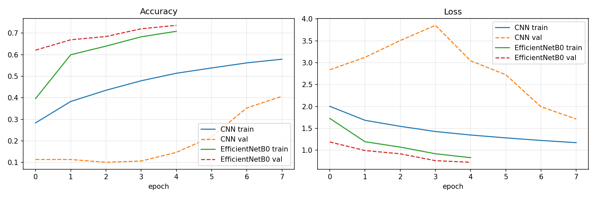
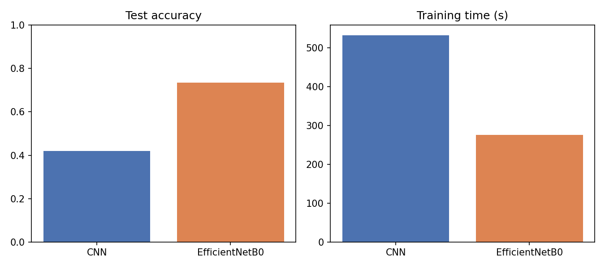

# CNN vs EfficientNetB0 on CIFAR-10

Computer Vision task: build a CNN on an image dataset, fine-tune a pretrained model (EfficientNetB0), and compare the results.

## Dataset
CIFAR-10 (10 classes, 32x32 color images). Because the experiment ran on a CPU runtime (no GPU available), a subset was used:
8,000 train / 1,000 validation / 2,000 test images.

## Models
1. **CNN from scratch**: 3 conv blocks (32, 64, 128 filters, each with 2 Conv layers + BatchNorm + MaxPool + Dropout), global average pooling, Dense(128), softmax. Trained for 8 epochs.
2. **EfficientNetB0 (pretrained on ImageNet)**: images upscaled to 64x64, then
   - Phase 1: freeze the base, train only the new classifier head (3 epochs, lr = 1e-3)
   - Phase 2: unfreeze the top 30 layers (BatchNorm kept frozen) and fine-tune (2 epochs, lr = 1e-4)

Both use the same data augmentation (horizontal flip + small translation) and the Adam optimizer.

## Results

| Model | Test Acc | Test Loss | Train Time (s) | Params | Epochs |
|---|---|---|---|---|---|
| CNN (from scratch) | 0.4195 | 1.6706 | 532 | 306,602 | 8 |
| EfficientNetB0 (pretrained) | 0.7345 | 0.7223 | 276 | 4,062,381 | 5 |




## Analysis
- EfficientNetB0 reached about 73% test accuracy versus about 42% for the CNN, with fewer epochs and less training time, even though it has about 13x more parameters.
- The reason is transfer learning: EfficientNet starts from features learned on ImageNet (edges, textures, shapes), while the CNN must learn everything from random weights using only 8,000 images.
- The CNN is much smaller (about 0.3M parameters) but its accuracy is limited by the small dataset and short training. With the full dataset, a GPU and more epochs, its accuracy would improve considerably (the same applies to EfficientNet).
- Conclusion: when data and compute are limited, fine-tuning a pretrained model is clearly the better choice.

## Notes on the curves
- **CNN validation accuracy starts very low (~11%) and then rises.** This is most likely because of BatchNorm: its moving averages need a few hundred training steps to match the real data statistics, and each epoch here has only 63 steps (8,000 images / batch 128). Validation accuracy catches up from epoch 4-5 onward, so the CNN was still improving when training stopped.
- **EfficientNet validation accuracy is higher than its training accuracy.** Training accuracy is measured with augmentation and dropout active, and averaged over the epoch while the model is still improving, so it is lower than the clean validation measurement.
- The EfficientNet curve has 5 epochs: epochs 0-2 are phase 1 (head only), epochs 3-4 are phase 2 (fine-tuning).

## How to run
```bash
pip install tensorflow matplotlib
python cnn_vs_efficientnet_cpu.py
```
The script downloads CIFAR-10 and the pretrained EfficientNetB0 weights automatically, trains both models, and saves `results.json`, `results.md`, `training_curves.png` and `comparison_bar.png`.
It is a light version (data subset, 64x64 images, few epochs) so it can run on a CPU in about 15 minutes. With a GPU, increase the subset sizes, image size and epochs for higher accuracy.
